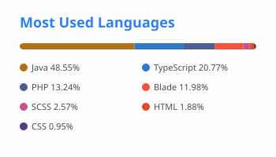

## Hi there 👋

### 🙋🏽 About me

- 👨🏽‍💻 I'm currently working on personal projects to keep improving my skills.
- 🌱 I'm learning how to implement hexagonal arquitecture in my projects.
- 👯 I'm looking to collaborate with [Kike](https://github.com/enrtorgil).
- 🤔 I'm free so if you have some offer ➡️ <a herf="mailto:eloylagarjaime@gmail.com">eloylagarjaime@gmail.com</a>
- ⚽ Fun fact: I somehow survive the weekend football games in Valencia's lowest league.

 

### 🎧 On repeat this week

<!-- SPOTIFY:START -->

**[El Endemoniao](https://stats.fm/track/366315145)**  
Alcalá Norte  
My most played track on Spotify in the last week · 28 plays · via <a href="https://stats.fm/viller">stats.fm</a>

 
<!-- SPOTIFY:END -->

### 📊 My GitHub Stats 

  
  

